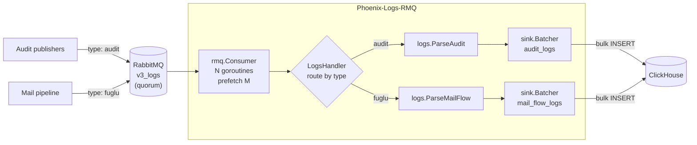
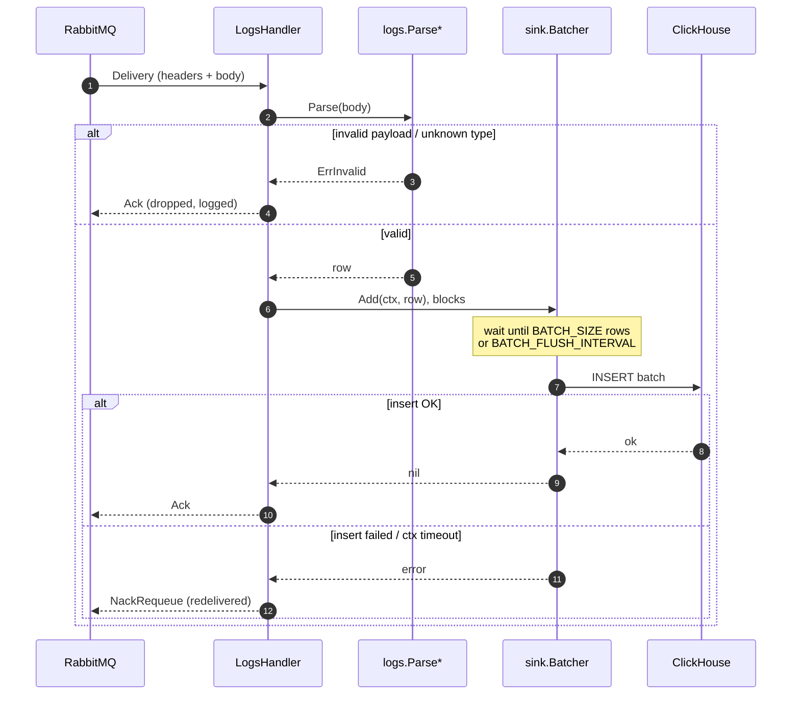
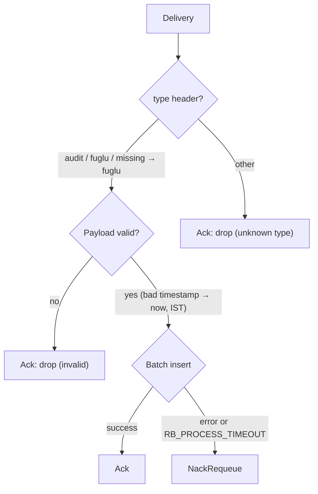
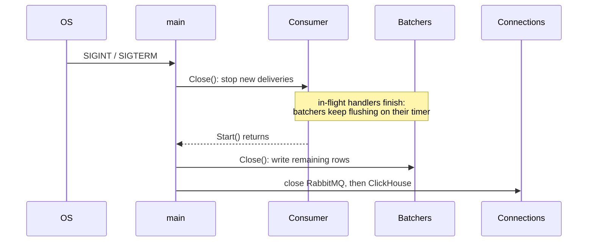

# Phoenix-Logs-RMQ

**A fast, reliable Go worker that consumes audit and mail-flow logs from RabbitMQ and bulk-inserts them into ClickHouse.**

[](https://github.com/Yukthi-Systems/Phoenix-Logs-RMQ/releases)
[](go.mod)
[](LICENSE)
[](https://discord.com/invite/2BS7Z4FhJ)

- [Features](#features)
- [Quick start](#quick-start)
- [Architecture](#architecture)
- [Configuration](#configuration)
- [Message formats](#message-formats)
- [Contributing](#contributing)
- [Community](#community)

---

## Overview

Phoenix-Logs-RMQ reads JSON log events from a RabbitMQ quorum queue, validates them, and writes them to ClickHouse in large batches. A message is acknowledged **only after its row has been stored**, so a ClickHouse outage or a crash never silently loses data. Messages are delivered at least once.

It handles two kinds of events, chosen by the AMQP `type` header:

| `type` header | Event | ClickHouse table |
|---|---|---|
| `audit` | User and admin actions (logins, setting changes...) | `audit_logs` |
| `fuglu` (default) | Mail-flow events from the mail pipeline | `mail_flow_logs` |

## Features

- **No message loss.** A message is acked after the bulk insert succeeds and requeued if the insert fails or times out.
- **High throughput.** Thousands of concurrent handlers feed size- and time-bounded batches (default: 500 rows or 2 s, whichever comes first).
- **Strict validation.** Malformed payloads are logged and dropped instead of being redelivered forever.
- **Graceful shutdown.** On `SIGINT`/`SIGTERM`, in-flight rows are written before the connections close.
- **Self-healing.** RabbitMQ reconnects automatically. ClickHouse failures turn into requeues, not crashes.
- **Production-ready image.** Static binary on Alpine, multi-arch (`amd64`/`arm64`).
- **12-factor config.** Everything comes from environment variables, with sensible defaults.
- **Structured logs.** JSON via zerolog, with built-in size and age rotation.

## Quick start

### With Docker Compose (everything local)

```bash
git clone https://github.com/Yukthi-Systems/Phoenix-Logs-RMQ.git
cd Phoenix-Logs-RMQ
docker compose up --build
```

This starts RabbitMQ (management UI at <http://localhost:15672>, login `phoenix` / `phoenix`), ClickHouse, and the worker. The worker does not create tables; create `audit_logs` and `mail_flow_logs` in ClickHouse yourself before publishing messages.

Publish a test message (or use [`scripts/rabbitmq.http`](scripts/rabbitmq.http)):

```bash
curl -u phoenix:phoenix -H 'content-type: application/json' \
  -X POST http://localhost:15672/api/exchanges/%2F/amq.default/publish -d '{
    "properties": {"headers": {"type": "audit"}},
    "routing_key": "v3_logs",
    "payload": "{\"organization_id\":\"org_1\",\"user_id\":\"u_1\",\"message\":\"User logged in\",\"action_type\":\"login\",\"action_timestamp\":\"2026-01-01T10:00:00Z\",\"details\":{}}",
    "payload_encoding": "string"
  }'

curl -u default:changeme 'http://localhost:8123/?query=SELECT+*+FROM+audit_logs+FORMAT+Pretty'
```

### With the Docker image

```bash
docker run -d --name phoenix-logs-rmq \
  -e RB_HOST=rabbitmq.internal -e RB_USERNAME=worker -e RB_PASSWD=secret \
  -e CLICK_HOUSE_HOST=clickhouse.internal -e CLICK_HOUSE_PASSWORD=secret \
  rjyspl/phoenix-logs-rmq:vX.Y.Z
```

See [DOCKERHUB.md](DOCKERHUB.md) for more deployment examples.

### From source

Requires the Go version in [`go.mod`](go.mod).

```bash
cp .env.example .env                        # defaults match the compose stack
docker compose up -d rabbitmq clickhouse    # or point .env at your own servers
make run
```

> [!WARNING]
> The worker **consumes and acks** messages. Point it at a test queue or vhost before you aim it at production.

## Architecture



### Message lifecycle

Each handler goroutine blocks until the batch holding its row is written, then returns the ack decision to the broker.



### Ack decisions



| Situation | Action | Why |
|---|---|---|
| Insert succeeded | `Ack` | The row is stored. |
| Body is not JSON, not an object, or a field is missing, null or the wrong type | `Ack` (dropped, logged at `error`) | It can never become valid. |
| `type` header is not `audit` or `fuglu` | `Ack` (dropped, logged) | No table to write it to. |
| Timestamp cannot be parsed | Row is **kept**, timestamp set to now (IST) | Losing the event is worse than an approximate time. |
| ClickHouse insert failed | `NackRequeue` | Redelivered and retried. |
| Per-message timeout or shutdown | `NackRequeue` | Redelivered and retried. |

> [!NOTE]
> At-least-once delivery means a row may occasionally be stored twice, for example when an insert succeeds just after the handler timed out. If you need exactly-once results, use a `ReplacingMergeTree` keyed on `euid` or ClickHouse insert deduplication.

### Batching

A batch is written when it reaches `BATCH_SIZE` rows **or** when `BATCH_FLUSH_INTERVAL` has passed since the last write, whichever happens first. A partial batch never waits indefinitely.

| Traffic | Behaviour |
|---|---|
| High (thousands/s) | Full batches of `BATCH_SIZE` are written immediately. |
| Low (about 10/s) | About 20 rows are written every 2 s. |
| A single message | Written after about 2 s. |
| Shutdown | Pending rows are written before exit. |

**Sizing rules**

1. **Concurrency ≥ batch size.** Each handler blocks until its batch is inserted, so filling a batch of N rows needs at least N handlers (`RB_WORKER_COUNT`) and N unacked messages (`RB_PREFETCH`). Both default to `2 × BATCH_SIZE`, because the two tables share them.
2. **`RB_PROCESS_TIMEOUT > BATCH_FLUSH_INTERVAL + CLICK_HOUSE_INSERT_TIMEOUT`.** Otherwise handlers give up while their batch is still being written, which causes requeues and duplicates. The worker logs a warning at startup if this rule is broken.

### Graceful shutdown



## Configuration

Configuration comes from environment variables. For local runs, a `.env` file in the working directory is also loaded; variables already set in the environment take precedence. The source of truth is [`internal/config/config.go`](internal/config/config.go), and [`.env.example`](.env.example) is a ready-to-copy template.

The worker **exits at startup** if a required variable is missing or the ClickHouse ping fails.

### RabbitMQ

| Variable | Default | Description |
|---|---|---|
| `RB_HOST` | **required** | Broker host |
| `RB_PORT` | `5672` | AMQP port |
| `RB_VHOST` | `/` | Virtual host (URL-escaped automatically) |
| `RB_USERNAME` | **required** | Broker user |
| `RB_PASSWD` | **required** | Broker password |
| `RB_CONSUME_QUEUE` | `v3_logs` | Queue to consume. Declared **durable + quorum**. |
| `RB_CONSUMER_TAG` | broker-assigned | Consumer name shown in RabbitMQ |
| `RB_WORKER_COUNT` | `2 × BATCH_SIZE` | Concurrent handler goroutines |
| `RB_PREFETCH` | `2 × BATCH_SIZE` | QoS prefetch count |
| `AMQPR_CON_DELAY` | `5s` | Delay between reconnect attempts |
| `RB_PROCESS_TIMEOUT` | `30s` | Per-message limit, including the wait for its batch |
| `MSG_TYPE_AUDIT` | `audit` | `type` header value for audit messages (case-insensitive) |
| `MSG_TYPE_MAIL_FLOW` | `fuglu` | `type` header value for mail-flow messages; also used when the header is missing. Must differ from `MSG_TYPE_AUDIT`. |

### Batching

| Variable | Default | Description |
|---|---|---|
| `BATCH_SIZE` | `500` | Maximum rows per insert |
| `BATCH_FLUSH_INTERVAL` | `2s` | Longest a partial batch waits |

### ClickHouse

| Variable | Default | Description |
|---|---|---|
| `CLICK_HOUSE_HOST` | **required** | Server host |
| `CLICK_HOUSE_PORT` | `8123` | `8123` for HTTP, `9000` for native |
| `CLICK_HOUSE_HTTP` | `true` | Set to `false` (with port `9000`) for the faster native protocol |
| `CLICK_HOUSE_USERNAME` | `default` | User |
| `CLICK_HOUSE_PASSWORD` | **required** | Password |
| `CLICK_HOUSE_DATABASE` | `default` | Database |
| `CLICK_HOUSE_AUDIT_LOGS_TABLE` | `audit_logs` | Audit table |
| `CLICK_HOUSE_MAIL_FLOW_LOGS_TABLE` | `mail_flow_logs` | Mail-flow table |
| `CLICK_HOUSE_INSERT_TIMEOUT` | `15s` | Timeout per insert |

### Logging

| Variable | Default | Description |
|---|---|---|
| `LOG_FILE` | `./logs/app.log` | Log file path (`/app/logs/app.log` in Docker) |
| `LOG_MAX_SIZE_MB` | `50` | Rotate at this size |
| `LOG_MAX_BACKUPS` | `5` | Rotated files to keep |
| `LOG_MAX_AGE_DAYS` | `14` | Days to keep rotated files |
| `LOG_COMPRESS` | `true` | Gzip rotated files |
| `LOG_LEVEL` | `debug` (`info` in Docker) | `trace`, `debug`, `info`, `warn`, `error` |
| `LOG_CONSOLE` | `false` | Also write logs to stderr |

## Message formats

### AMQP headers

| Header | Values | Default |
|---|---|---|
| `type` | `audit` or `fuglu` (case-insensitive; set with `MSG_TYPE_AUDIT` / `MSG_TYPE_MAIL_FLOW`) | `MSG_TYPE_MAIL_FLOW` (`fuglu`) when missing |

The header may arrive as a string or as raw bytes, depending on the publisher. Both are accepted.

### `audit` body

All fields are required and must not be null. Unknown fields are ignored.

```json
{
  "organization_id": "org_123",
  "user_id": "user_456",
  "message": "User logged in",
  "action_type": "login",
  "action_timestamp": "2026-01-01T10:00:00+05:30",
  "details": { "ip": "203.0.113.7" }
}
```

| Field | Type | Notes |
|---|---|---|
| `organization_id`, `user_id`, `message`, `action_type` | string | |
| `action_timestamp` | ISO 8601 string | If it cannot be parsed, it is set to now (IST). |
| `details` | JSON object | Stored as JSON text |

### `fuglu` (mail-flow) body

```json
{
  "euid": "e-0001",
  "from_email_id": "alice@example.com",
  "to_email_ids": ["bob@example.org"],
  "email_domains": ["example.org"],
  "subject": "Hello",
  "type": "Incoming",
  "status": "Accepted",
  "status_description": "250 OK",
  "log_timestamp": "2026-01-01T10:00:00+05:30",
  "email_timestamp": "2026-01-01 10:00:00.123456",
  "meta_data": { "size": 1234 }
}
```

| Field | Type | Notes |
|---|---|---|
| `euid`, `from_email_id`, `subject`, `type`, `status`, `status_description` | string | |
| `to_email_ids` | array of strings | `null` elements are rejected |
| `email_domains` | array of strings | |
| `log_timestamp`, `email_timestamp` | ISO 8601 string | If **either** cannot be parsed, **both** are set to the same "now" (IST). |
| `meta_data` | JSON object | Stored as JSON text |

### Timestamps

Accepted formats: `T` or a space as the separator, optional fractional seconds, an optional zone (`Z`, `+05:30`, `+0530`), and date-only values (`2026-01-01`). A timestamp **without a zone is read as IST** (Asia/Kolkata, UTC+05:30).

### ClickHouse tables

Column order is defined in [`internal/model/model.go`](internal/model/model.go) and must match your tables. The worker does not create databases or tables; they must already exist.

| Go value | ClickHouse type |
|---|---|
| `string` | `String` |
| `[]string` (email lists) | `Array(String)` |
| `time.Time` | `DateTime` / `DateTime64` |
| `details`, `meta_data` (JSON text) | `String` or `JSON` |

## Project layout

The project follows the standard Go [`cmd/` + `internal/`](https://go.dev/doc/modules/layout) layout. Every package and function is documented. Browse the documentation with `go doc ./internal/sink` or [pkg.go.dev](https://pkg.go.dev/github.com/Yukthi-Systems/Phoenix-Logs-RMQ).

```text
.
├── cmd/phoenix-logs-rmq/     # main: wiring, signals, ordered shutdown
├── internal/
│   ├── config/               # environment / .env → Config
│   ├── logger/               # zerolog + lumberjack rotating JSON log
│   ├── model/                # payload structs, table column order, type constants
│   ├── logs/                 # validation: body → ClickHouse row
│   ├── rmq/                  # RabbitMQ connection, consumer, LogsHandler
│   └── sink/                 # size/interval batcher, ClickHouse connection
├── scripts/rabbitmq.http     # manual test requests
├── Dockerfile                # multi-stage Alpine runtime image
├── docker-compose.yaml       # local RabbitMQ + ClickHouse + worker
└── Makefile                  # `make` lists all targets
```

## Development

```bash
make check         # gofmt + vet + race tests + build (same as CI)
make test          # go test ./... -race
make cover         # coverage.html
make build         # static binary in ./bin (version from git describe)
make docker-build  # rjyspl/phoenix-logs-rmq:<version>
```

### Extending

| To... | Edit |
|---|---|
| Add a new log type | A constant, struct and column list in `internal/model`; a `ParseX` in `internal/logs`; a `case` in `rmq/handler.go`; a batcher in `cmd/phoenix-logs-rmq/main.go` |
| Change validation rules | `internal/logs/audit.go`, `internal/logs/mailflow.go` |
| Change ack or requeue behaviour | `LogsHandler.Process` in `internal/rmq/handler.go` |
| Change batching | `internal/sink/batcher.go` |
| Add a setting | `internal/config/config.go`, `.env.example`, and this README |

## Roadmap and known limitations

- **Poison batches.** If ClickHouse rejects a whole batch because of one bad row, the batch is requeued repeatedly. Planned fix: retry row by row and dead-letter the rows that fail.
- **Metrics.** A Prometheus `/metrics` endpoint and HTTP health probes are planned.

Ideas and pull requests are welcome. See the [issues](https://github.com/Yukthi-Systems/Phoenix-Logs-RMQ/issues).

## Contributing

Contributions are welcome! Please read [CONTRIBUTING.md](CONTRIBUTING.md) and our [Code of Conduct](CODE_OF_CONDUCT.md) first.

- 🐛 [Report a bug](https://github.com/Yukthi-Systems/Phoenix-Logs-RMQ/issues/new?template=bug_report.yml)
- ✨ [Request a feature](https://github.com/Yukthi-Systems/Phoenix-Logs-RMQ/issues/new?template=feature_request.yml)
- 🔒 Found a vulnerability? Please follow [SECURITY.md](SECURITY.md) and **do not** open a public issue.

## Community

| Channel | Link |
|---|---|
| 💬 Discord | <a href="https://discord.com/invite/2BS7Z4FhJ" target="_blank" rel="noopener noreferrer">discord.com/invite/2BS7Z4FhJ</a> |
| ✉️ Email | <a href="mailto:connect@yukthi.com">connect@yukthi.com</a> |
| 🐳 Docker Hub | <a href="https://hub.docker.com/r/rjyspl/phoenix-logs-rmq" target="_blank" rel="noopener noreferrer">rjyspl/phoenix-logs-rmq</a> |

## Acknowledgements

- Built on [wagslane/go-rabbitmq](https://github.com/wagslane/go-rabbitmq), [ClickHouse/clickhouse-go](https://github.com/ClickHouse/clickhouse-go), [rs/zerolog](https://github.com/rs/zerolog), [natefinch/lumberjack](https://github.com/natefinch/lumberjack) and [joho/godotenv](https://github.com/joho/godotenv).
- Scaffolded from [RabbitMQ-Consumer-Template](https://github.com/chetuachar/RabbitMQ-Consumer-Template).

## License

Copyright © 2026 Yukthi Systems Private Limited.

Phoenix-Logs-RMQ is free software: you can redistribute it and/or modify it under the terms of the **GNU General Public License v3.0**. See [LICENSE](LICENSE) for the full text.
